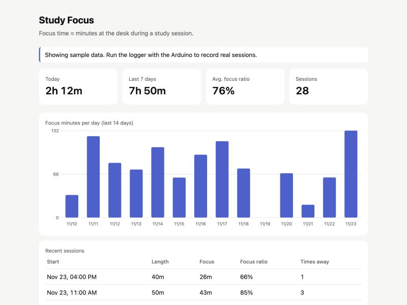

# Study Focus Tracker

[](https://github.com/Ester0Awad/study-focus-tracker/actions/workflows/test.yml)

A desk device that tracks how long I actually study. An Arduino detects when I'm sitting at my desk, a button starts and stops study sessions, and a web dashboard shows my focus time per day.



**Why:** I wanted real numbers on my study habits instead of guessing. Timers and apps don't know if I actually stayed at my desk. This does.

## How it works

```
[Ultrasonic sensor] --\
                       +--> [Arduino Uno] --USB serial--> [Laptop logger] --> sessions.json --> [Web dashboard]
[Button] + [LED] -----/
```

1. **Arduino Uno** measures the distance to my chair with an ultrasonic sensor. If something is closer than a threshold for a few seconds, I'm "at the desk."
2. **Button** starts and stops a study session. The **LED** is on while a session is running.
3. During a session, time only counts as **focus time** while I'm at the desk, so breaks are excluded automatically.
4. The Arduino prints one JSON event per line over USB serial.
5. A **Node.js logger** on my laptop reads those events and saves sessions to a file.
6. A **web dashboard** charts focus minutes per day.

## Parts

| Part | Qty | Notes |
|---|---|---|
| Arduino Uno | 1 | |
| HC-SR04 ultrasonic distance sensor | 1 | Usually included in Arduino starter kits |
| Push button | 1 | |
| LED + 220 Ω resistor | 1 | |
| Breadboard + jumper wires | | |
| USB cable | 1 | Power + data to the laptop |

## Wiring

| Arduino pin | Connects to |
|---|---|
| 5V | HC-SR04 VCC |
| GND | HC-SR04 GND, button, LED (via resistor) |
| D9 | HC-SR04 TRIG |
| D10 | HC-SR04 ECHO |
| D2 | Button (other leg to GND; uses the internal pull-up) |
| D13 | LED (+ leg), LED (−) leg through 220 Ω to GND |

## Firmware

Open `firmware/study_focus_tracker/study_focus_tracker.ino` in the Arduino IDE, select **Arduino Uno**, and upload. Open the Serial Monitor at **115200 baud** to see events like:

```json
{"event":"session_start","ms":5120,"focus_ms":0,"session_ms":0}
{"event":"present","ms":8340,"focus_ms":0,"session_ms":3220}
{"event":"away","ms":912400,"focus_ms":904060,"session_ms":907280}
{"event":"session_end","ms":930000,"focus_ms":904060,"session_ms":924880}
```

Tune `PRESENT_DISTANCE_CM` at the top of the file to match the distance from the sensor to your chair.

## Logger

Requires Node.js 20+.

```sh
cd logger
npm install
npm test                                  # unit tests, no hardware needed
npm start -- --replay sample-events.txt   # try it without the Arduino
npm start -- /dev/tty.usbmodem1101        # real device (macOS: ls /dev/tty.usb*; Windows: COM3)
```

Each finished session is appended to `data/sessions.json`:

```json
{ "started_at": "...", "ended_at": "...", "session_minutes": 50, "focus_minutes": 44.9, "focus_ratio": 0.9, "away_count": 1 }
```

To open your sessions in Excel or Google Sheets, run `npm run export-csv`, which writes `data/sessions.csv`.

## Dashboard

```sh
cd logger
npm run dashboard   # then open http://localhost:5173
```

Shows today's focus time, the last 7 days, the average focus ratio, your study streak, a chart of focus minutes per day, and recent sessions. Until you've recorded real sessions it shows sample data (`dashboard/sample-sessions.json`).

The streak counts days in a row with at least 30 focus minutes. To use a different daily goal, add it to the URL, for example `http://localhost:5173/?goal=60`.

For a quick look in the terminal instead:

```sh
npm run summary              # last 7 days as a text bar chart, total, and streak
npm run summary -- --sample  # same, using the sample data
```

## Tuning

All settings are constants at the top of `firmware/study_focus_tracker/study_focus_tracker.ino`:

| Setting | Default | What it does |
|---|---|---|
| `PRESENT_DISTANCE_CM` | 70 | Anything closer than this counts as someone at the desk |
| `PRESENT_CONFIRM_MS` | 3000 | How long you must be near before you count as present |
| `AWAY_CONFIRM_MS` | 5000 | How long you must be gone before you count as away |
| `STATUS_INTERVAL_MS` | 60000 | How often a `status` event is printed during a session |

To pick `PRESENT_DISTANCE_CM`, open the Serial Monitor, sit normally, then lean back and stand up, and watch where the `present`/`away` events switch. Set it a little beyond your normal sitting distance.

## Troubleshooting

| Problem | Fix |
|---|---|
| Logger says it can't find the port | Close the Arduino IDE's Serial Monitor (only one program can use the port), then check the port name (`ls /dev/tty.usb*` on Mac) and pass it: `npm start -- /dev/tty.usbmodem1101`, or `npm start -- COM3` on Windows. |
| Serial Monitor shows garbled text | Set the baud rate to **115200**. |
| It always says `away` | Check TRIG is on D9 and ECHO on D10, and that the sensor faces where you sit. Very soft surfaces like a hoodie can absorb the sound, so try aiming at your chest or face. |
| The button starts and stops many times | The wire is loose, or it's not wired from D2 to GND. |
| A session disappeared | Sessions are only saved when they end. If the board resets (USB unplugged) during a session, that session is dropped. |

## Roadmap

- [x] Project plan, parts and wiring
- [x] Arduino firmware: presence detection, button, LED, JSON events over serial
- [x] Laptop logger: read serial events, save sessions
- [x] Web dashboard: focus minutes per day
- [ ] Photos, wiring diagram and demo video
- [x] Study streak with a daily goal
- [ ] Stretch: weekly goals and a small OLED display on the device

## License

MIT
